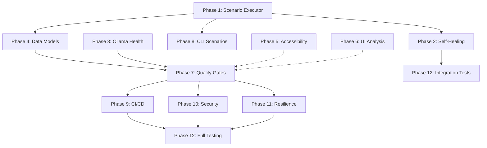

# Autonomous Quality Engineering Platform – Implementation Roadmap

**Status:** MVP Complete, Production Hardening Phase  
**Last Updated:** 2026-11-06  
**Total Estimated Effort:** ~270 person-hours (6-8 weeks for single engineer)

---

## Executive Summary

The Autonomous Quality Engineering Platform has a **functional MVP** that can:
- ✅ Safely crawl public websites
- ✅ Discover pages, elements, forms, and navigation patterns
- ✅ Run deterministic quality checks (accessibility, broken images, form validation)
- ✅ Integrate with local Ollama for AI enrichment
- ✅ Generate HTML/JSON/Allure reports

**Critical Gap:** The platform does **not yet execute AI-generated test scenarios** or perform **self-healing locator recovery** during test runs. This is the primary blocker for true autonomous testing.

---

## Audit Findings at a Glance

| Module | Status | Completeness | Critical Gaps |
|--------|--------|--------------|----------------|
| **shared** | ✅ MVP | 70% | No scan metadata, evidence model, execution results |
| **core-engine** | ✅ MVP | 65% | No test execution, search/download flows, performance metrics |
| **ai-agents** | ⚠️ Partial | 55% | No executable scenarios, Ollama health checks, confidence metrics |
| **accessibility-engine** | ⚠️ Limited | 40% | No WCAG rules, keyboard audit, contrast checks |
| **ui-analysis** | 🔴 Skeleton | 25% | No visual regression, layout checks, responsive testing |
| **self-healing** | ✅ Functional | 60% | Not integrated into execution workflow |
| **reporting** | ✅ MVP | 70% | No quality gates, CI exit codes, standard exports |
| **platform-cli** | ⚠️ Basic | 50% | No config files, structured logging, scenario execution command |

---

## 12-Phase Implementation Plan

### Phase 1: Autonomous Test Execution Engine (Priority: CRITICAL)
**Estimated: 30-40 hours | Blocks:** Phase 2-8

**Why First?** Without executable test scenarios, the platform remains a passive analyzer. This unblocks the entire autonomous testing workflow.

#### Deliverables:
1. `ActionContext` interface — abstraction for Playwright interactions
2. `ScenarioExecutor` — converts `QualityScenario` to actions + assertions
3. `SearchFlowExecutor` — search form fill/submit/result validation
4. `DownloadFlowExecutor` — safe download initiation and verification
5. `NavigationFlowExecutor` — page navigation and breadcrumb traversal
6. `ExecutionResult` — captures pass/fail, assertion details, screenshots

**Key Classes to Create:**
```
core-engine/src/main/java/io/aqep/core/execution/
  ├── ActionContext.java
  ├── ScenarioExecutor.java
  ├── SearchFlowExecutor.java
  ├── DownloadFlowExecutor.java
  ├── NavigationFlowExecutor.java
  └── ExecutionResult.java

shared/src/main/java/io/aqep/shared/
  ├── Action.java (sealed enum)
  └── Assertion.java (sealed enum)
```

---

### Phase 2: Self-Healing Integration (Priority: CRITICAL)
**Estimated: 15-20 hours | Depends On:** Phase 1

#### Deliverables:
1. `HealingContext` — wraps `SelfHealingLocator` with action logging
2. Connect `OllamaQualityAgent.suggestLocator()` → `SelfHealingLocator`
3. Healing telemetry (success rate, alternatives tried)
4. Healing validation layer (verify suggested locators work)

**Key Files to Modify:**
- `self-healing/src/main/java/io/aqep/healing/SelfHealingLocator.java`
- Create `self-healing/src/main/java/io/aqep/healing/HealingContext.java`
- Integrate into `core-engine/src/main/java/io/aqep/core/execution/ScenarioExecutor.java`

---

### Phase 3: Ollama Robustness (Priority: HIGH)
**Estimated: 10-15 hours | Depends On:** Phase 1

#### Deliverables:
1. Ollama health check on startup
2. Model availability verification
3. Fallback model strategy (if primary unavailable)
4. Timeout/circuit-breaker patterns
5. Structured output validation (JSON schema)
6. Confidence scoring

**New Classes:**
```
ai-agents/src/main/java/io/aqep/ai/
  ├── OllamaHealthCheck.java
  ├── ModelRegistry.java
  └── ConfidenceScorer.java
```

---

### Phase 4: Enhanced Data Models (Priority: HIGH)
**Estimated: 18-24 hours | Depends On:** Phase 1, 3

#### Deliverables:
1. **Finding Enhancement** — stable IDs, rule metadata, WCAG mappings
2. **Evidence Bundle** — DOM snapshot + screenshot + coordinates + logs
3. **Scan Metadata** — scan ID, browser, config snapshot, timing
4. **Execution Result Model** — scenario outcomes, assertion state

**New Classes:**
```
shared/src/main/java/io/aqep/shared/
  ├── FindingRule.java
  ├── EvidenceBundle.java
  ├── ScanMetadata.java
  ├── AssertionResult.java
  └── TestExecutionResult.java
```

---

### Phase 5: Accessibility Enhancements (Priority: MEDIUM)
**Estimated: 20-28 hours | Parallel**

#### Deliverables:
1. WCAG 2.1/2.2 rule engine (60+ rules)
2. Heading hierarchy validation
3. Color contrast checking (WCAG AA/AAA)
4. Keyboard navigation audit (tab order, traps, focus)
5. Landmark structure validation
6. Semantic HTML checks

**Strategy:** Build atop existing `AccessibilityAnalyzer` with a rule registry.

---

### Phase 6: UI Analysis Expansion (Priority: MEDIUM)
**Estimated: 20-28 hours | Parallel**

#### Deliverables:
1. Visual regression detection
2. Layout overflow/overlap detection
3. Responsive viewport testing (3+ breakpoints)
4. Broken link full validation
5. Missing/hidden/disabled control analysis
6. Font loading verification

---

### Phase 7: Reporting & Quality Gates (Priority: HIGH)
**Estimated: 18-25 hours | Depends On:** Phase 4

#### Deliverables:
1. Configurable quality gate framework
2. Deterministic exit codes
3. SARIF export (vulnerability standard)
4. JUnit XML export (CI integration)
5. CSV accessibility reports
6. Baseline comparison and trend analysis

**New Classes:**
```
reporting/src/main/java/io/aqep/reporting/
  ├── QualityGate.java
  ├── QualityGatePolicy.java
  ├── SarifReportWriter.java
  ├── JunitReportWriter.java
  └── BaselineComparison.java
```

---

### Phase 8: CLI Hardening (Priority: MEDIUM)
**Estimated: 18-24 hours | Depends On:** Phase 1, 7

#### Deliverables:
1. Typed argument parser (Picocli or custom)
2. Configuration file support (YAML/JSON)
3. Structured logging with debug mode
4. Scenario execution command
5. Progress tracking and cancellation
6. Dry-run mode

**Modify:**
- `platform-cli/src/main/java/io/aqep/cli/AqepApplication.java`

---

### Phase 9: Docker & CI/CD (Priority: MEDIUM)
**Estimated: 12-16 hours | Parallel to Phase 7-8**

#### Deliverables:
1. Multi-stage Docker build optimization
2. Embedded Ollama model loading
3. GitHub Actions workflow
4. Testcontainers integration tests
5. Container scanning artifacts

**Files:**
- `Dockerfile` (enhance)
- `docker-compose.yml` (enhance)
- `.github/workflows/aqep-scan.yml` (new)

---

### Phase 10: Security Hardening (Priority: MEDIUM)
**Estimated: 15-20 hours | Parallel**

#### Deliverables:
1. DOM/URL/console redaction before AI
2. Scan authorization layer (whitelist/policy)
3. Secrets detection in reports
4. Privacy-safe asset paths
5. Cryptographic scan IDs

**New Classes:**
```
shared/src/main/java/io/aqep/shared/security/
  ├── RedactionPolicy.java
  ├── ScanAuthorization.java
  └── SecretsDetector.java
```

---

### Phase 11: Production Resilience (Priority: MEDIUM)
**Estimated: 22-30 hours | Parallel**

#### Deliverables:
1. Comprehensive error handling and recovery
2. Retry/backoff strategies
3. Resource budgeting (memory, CPU, bandwidth)
4. Scan checkpointing and resume
5. Partial failure handling

**Modify:**
- `core-engine/src/main/java/io/aqep/core/SiteCrawler.java`
- Create `platform-cli/src/main/java/io/aqep/cli/ScanCheckpoint.java`

---

### Phase 12: Testing & Validation (Priority: HIGH)
**Estimated: 22-30 hours | Final Phase**

#### Deliverables:
1. End-to-end integration tests (all workflows)
2. Performance benchmarks
3. Security policy tests
4. Real-world website scanning samples

---

## Quick-Start Implementation Order

For maximum velocity, implement in this order:

1. ✅ **Phase 1** — Scenario Execution Engine (CRITICAL)
2. ✅ **Phase 4a** — Core data models (Finding, Evidence)
3. ✅ **Phase 2** — Self-Healing Integration (CRITICAL)
4. ✅ **Phase 3** — Ollama Health & Confidence
5. ✅ **Phase 8** — CLI Scenario Execution Command
6. ✅ **Phase 7** — Quality Gates & Exit Codes
7. 🔄 **Phase 5** — Accessibility (parallel)
8. 🔄 **Phase 6** — UI Analysis (parallel)
9. ✅ **Phase 9** — Docker & CI/CD
10. ✅ **Phase 10** — Security Hardening
11. ✅ **Phase 11** — Production Resilience
12. ✅ **Phase 12** — Testing & Validation

---

## Dependency Graph (Mermaid)



---

## Success Metrics

| Metric | Target | Current |
|--------|--------|---------|
| Autonomous test execution | ✅ Functional | ❌ Missing |
| Self-healing recovery rate | ≥90% | N/A (not integrated) |
| WCAG accessibility coverage | ≥80 rules | ~4 rules |
| Report export formats | 5+ (HTML, JSON, Allure, SARIF, JUnit) | 3 (HTML, JSON, Allure) |
| CI/CD integration | ✅ Automated | ⚠️ Manual |
| Quality gate automation | ✅ Configurable | ❌ Fixed thresholds |
| Production uptime SLA | 99.5% | N/A (MVP) |

---

## Risk Mitigation

| Risk | Mitigation |
|------|------------|
| Ollama model unavailable | Phase 3 health checks + fallback strategy |
| Locator healing fails | Phase 2 safety validation + manual recipe override |
| Performance regression | Phase 12 benchmarks + resource limits (Phase 11) |
| Security/privacy leaks | Phase 10 redaction + secrets detection |
| Partial scan failure | Phase 11 checkpointing + robust error handling |

---

## References

- **Architecture Design:** `docs/architecture.md`
- **API Specifications:** `docs/api.md`
- **CI/CD Setup:** `.github/workflows/`
- **Docker Configuration:** `docker-compose.yml`

---

## Next Steps

1. **Immediate** (Today): 
   - Review this roadmap
   - Discuss Phase 1 implementation approach
   - Set up development environment

2. **Week 1**:
   - Complete Phase 1 (Scenario Executor)
   - Complete Phase 4a (Core data models)
   - Begin Phase 2 (Self-Healing integration)

3. **Week 2-3**:
   - Complete Phase 2, 3, 8
   - Parallel: Phase 5, 6
   - Integration testing

4. **Week 4+**:
   - Security (Phase 10)
   - Resilience (Phase 11)
   - Full validation (Phase 12)

---

**Owner:** Principal SDET/QA Architect  
**Status:** Ready for implementation  
**Last Review:** 2026-11-06
